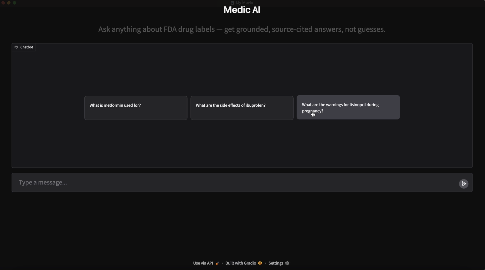
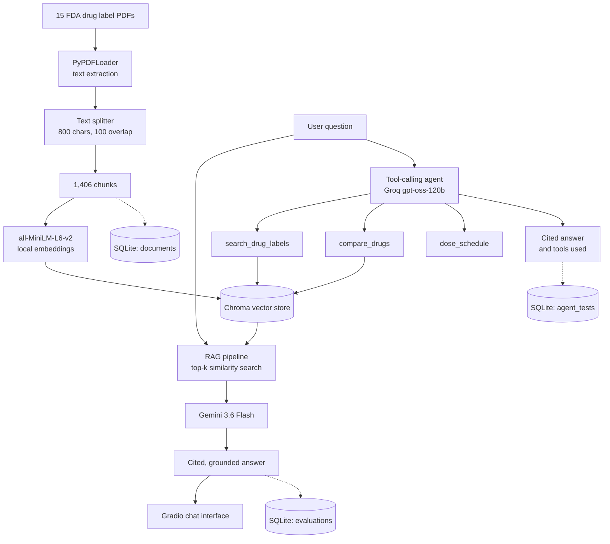
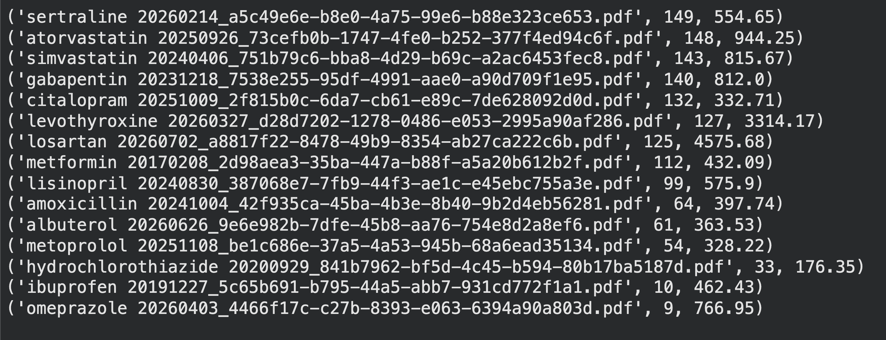
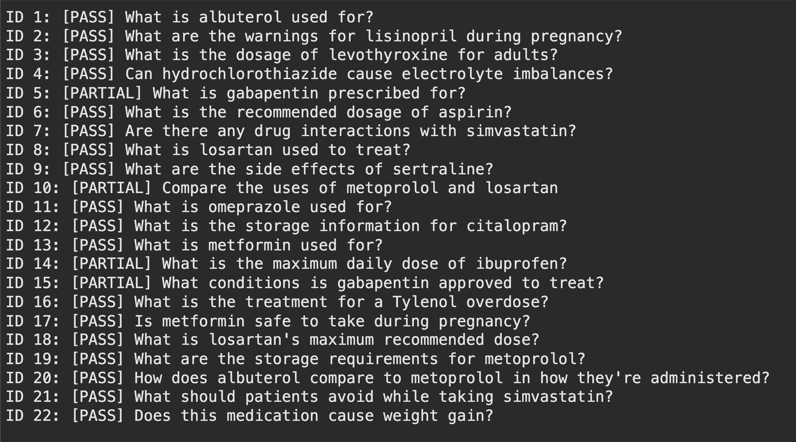
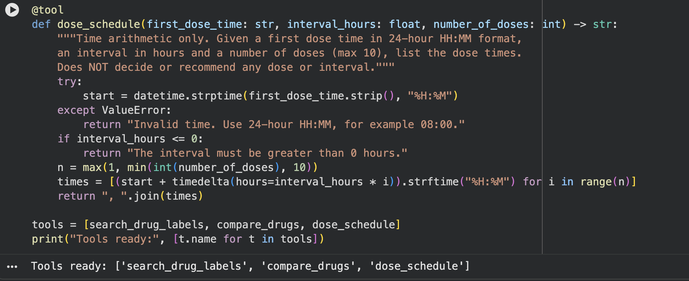
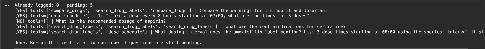
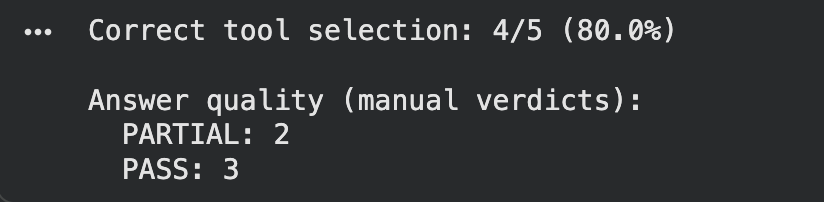

# Medic AI: Healthcare Document RAG Assistant

An AI assistant that answers questions about FDA drug labels using only the documents it was given, cites its sources, and says so when it does not know.

## Highlights

- **Grounded answers with citations** over 15 FDA drug labels (1,406 text chunks), using RAG with local embeddings, Chroma and Gemini.
- **Structured evaluation in SQL:** 22 test questions logged in SQLite with expected behavior, answer and verdict. Result: 18 PASS, 4 PARTIAL, 0 FAIL, no fabricated answers observed in this test set.
- **Tool-calling agent** with 3 tools (label search, two-drug comparison, dose-time calculator). On a 5-question agent test set it chose the expected tools in 4 of 5 cases (80%), with 3 PASS and 2 PARTIAL answers.
- **Honest limitations:** every partial result and failure mode is documented below, not hidden.

## Overview

Medic AI is a Retrieval-Augmented Generation (RAG) assistant that answers questions about FDA drug labels using only the content of a curated document set, rather than general model knowledge. It is built for researchers, students, or anyone who needs to quickly verify specific drug information (dosages, warnings, interactions, storage) without reading through long prescribing documents. The system retrieves relevant passages from the source PDFs, generates a grounded answer with Google's Gemini API, and cites which document each answer came from. When the information is not in the dataset, it says so instead of guessing.

The project also includes a LangChain tool-calling agent that decides which tool to use for a question, for example comparing two drugs or turning a label's dosing interval into clock times.

## Problem Statement

FDA drug labels contain dense, safety-critical information, but they are long, inconsistently structured and time-consuming to search by hand. A plain LLM-only approach risks a serious failure in healthcare: confidently producing plausible but incorrect information when it does not actually know the answer. This project addresses both problems with a retrieval-first system that answers only from verified source documents and explicitly states when information is not available.

## Demo



[Watch the demo video](https://www.linkedin.com/posts/fatema-alam-074496249_ai-machinelearning-rag-activity-7506455012366180353-ltDS)

## Architecture



The Gradio app runs the RAG pipeline by default. A switch in the notebook (`USE_AGENT`) routes chat messages through the agent instead and shows which tools were used.

## Dataset

15 FDA drug label PDFs from [DailyMed](https://dailymed.nlm.nih.gov/dailymed/) (U.S. National Library of Medicine): albuterol, amoxicillin, atorvastatin, citalopram, gabapentin, hydrochlorothiazide, ibuprofen, levothyroxine, lisinopril, losartan, metformin, metoprolol, omeprazole, sertraline and simvastatin. The raw PDFs are in the `data/` folder for reproducibility.

## Tech Stack

Python, LangChain (RAG, tools and agents), LangGraph, Google Gemini API (`gemini-3.6-flash`) for answer generation, Groq API (`openai/gpt-oss-120b`) for the agent, HuggingFace sentence-transformers (`all-MiniLM-L6-v2`) for local embeddings, Chroma (vector database), SQLite (SQL), Gradio, Google Colab.

## User Stories & Acceptance Criteria

**User Story 1**
As a researcher or student, I want to ask natural-language questions about a specific drug's warnings or side effects, so that I can quickly verify safety information without reading an entire label document.

*Acceptance Criteria:*
- Given a question about a drug in the document set, when it is submitted, then the system returns an answer grounded in that drug's label, with the source filename cited.
- Given a question about a drug NOT in the document set, when it is submitted, then the system states that the information is not available instead of generating an unsupported answer.

**User Story 2**
As a user asking an ambiguous question (no drug named), I want the system to handle the ambiguity sensibly, so that I still get a useful answer instead of a dead end.

*Acceptance Criteria:*
- Given a question that does not name a drug, when several drugs in the document set could be relevant, then the system addresses the most relevant candidates individually instead of picking one arbitrarily.

**User Story 3**
As a developer evaluating this system, I want a structured, repeatable way to test its accuracy and failure modes, so that its reliability is documented rather than assumed.

*Acceptance Criteria:*
- Given test questions covering factual lookups, ambiguous phrasing, cross-document comparisons and out-of-scope drugs, when they are run through the system, then the question, expected behavior, actual answer and verdict are logged to a queryable database.

**User Story 4**
As a user with a multi-step question (for example comparing two drugs, or turning a label's dosing interval into clock times), I want the assistant to choose the right tool for each step, so that the answer is built from the labels and not from a single generic search.

*Acceptance Criteria:*
- Given a request to compare two drugs, when it is submitted, then the agent calls the comparison tool and returns a separate, cited section for each drug.
- Given a request for dose times from a stated interval, when it is submitted, then the agent uses the schedule tool for the arithmetic and does not recommend a dose.
- Given a drug that is not in the dataset, when it is submitted, then the agent says the labels do not cover it.

## SQL Usage

Three SQLite tables support the project:

```sql
CREATE TABLE documents (
    id INTEGER PRIMARY KEY AUTOINCREMENT,
    filename TEXT NOT NULL,
    filepath TEXT NOT NULL,
    chunk_count INTEGER,
    file_size_kb REAL,
    date_processed TEXT
);

CREATE TABLE evaluations (
    id INTEGER PRIMARY KEY AUTOINCREMENT,
    question TEXT NOT NULL,
    expected_behavior TEXT,
    actual_answer TEXT,
    passed TEXT,
    date_tested TEXT
);

CREATE TABLE agent_tests (
    id INTEGER PRIMARY KEY AUTOINCREMENT,
    question TEXT NOT NULL,
    expected_tools TEXT,
    tools_used TEXT,
    tool_correct TEXT,
    answer TEXT,
    passed TEXT,
    date_tested TEXT
);
```

Example query that summarizes the evaluation results:

```sql
SELECT passed, COUNT(*) FROM evaluations GROUP BY passed;
```



## Evaluation & Testing

22 test questions were run against the RAG pipeline. They cover factual lookups across all 15 documents, hallucination checks (drugs that are not in the dataset), a grounding check (not relying on general medical knowledge), cross-document comparisons, and an ambiguous question with no drug named. Verdicts were assigned manually by the author after reading each answer.

**Results: 18 PASS, 4 PARTIAL, 0 FAIL.** No fabricated answers were observed in this test set.



The system correctly declined to answer questions about drugs outside its document set (aspirin, Tylenol) instead of inventing a plausible answer, which is the most important behavior for a healthcare tool.

**The 4 PARTIAL results:**

| Question | What happened |
|---|---|
| What is gabapentin prescribed for? | Found only a narrow pediatric epilepsy mention and did not give the main indications |
| What conditions is gabapentin approved to treat? | Same gap, reproduced in a second test |
| Compare the uses of metoprolol and losartan | Declined to give a full comparison because the retrieved text was incomplete |
| What is the maximum daily dose of ibuprofen? | Said the maximum dose was not in the retrieved text |

In all four cases the system was cautious instead of wrong, but it did not fully answer. The gabapentin result appeared twice, which points to a retrieval gap. This is an inference from the answers and was not confirmed by inspecting the chunks.

## Agent Upgrade (Tool Calling)

Beyond the fixed retrieve-then-answer pipeline, a LangChain agent decides which tool to use for each question:

| Tool | Purpose |
|---|---|
| `search_drug_labels` | Retrieves label passages (the existing retriever, wrapped as a tool) |
| `compare_drugs` | Pulls the same topic from two drugs' own labels so the drugs are not mixed up |
| `dose_schedule` | Time arithmetic only (for example every 8 hours from 08:00). It never recommends a dose. |

Guardrails: answers must come from tool results with source filenames cited, drugs outside the dataset are declined, and no personal medical advice is given.



### Agent evaluation

5 questions, logged in the SQLite `agent_tests` table, with the expected tools defined before running.

- **Correct tool selection: 4 of 5 (80%)**
- **Answer quality: 3 PASS, 2 PARTIAL, 0 FAIL**



| Test | Tools used | Result |
|---|---|---|
| Compare lisinopril and losartan | `compare_drugs`, `search_drug_labels`, `compare_drugs` | PARTIAL: answer was cited but led with minor items and omitted the lisinopril label's boxed fetal-toxicity warning |
| Dose times for an 8-hour interval from 07:00 | `dose_schedule` | PASS |
| Recommended dosage of aspirin (not in dataset) | none | PASS: correct refusal. It answered without searching, so it counts as a tool-selection miss. |
| Contraindications for sertraline | `search_drug_labels` (3 calls) | PARTIAL: listed 2 contraindications and omitted pimozide, which the label also lists |
| Amoxicillin dosing interval, then 3 dose times from 08:00 | `search_drug_labels`, `dose_schedule` | PASS: interval matched the label, times 08:00, 16:00 and 00:00 correct |




**Model note:** the RAG answers use Gemini 3.6 Flash. The agent evaluation was run on Groq `openai/gpt-oss-120b` with low reasoning effort, because the Gemini free-tier quota was exhausted and Groq's free tier limits tokens per minute. The two sets of results therefore come from different models and are not directly comparable.

## How to Run

1. Open the notebook in the `notebook/` folder in Google Colab.
2. Copy the PDFs from `data/` into `MyDrive/Healthcare_AI_RAG_Assistant/FDA Drug Levels PDF/` on Google Drive (or edit the paths cell).
3. Add Colab secrets: `GEMINI_API_KEY` for the RAG answers and `GROQ_API_KEY` for the agent. Never put keys in the notebook.
4. Run the cells top to bottom. Cells that call an LLM (`RUN_DEMO_QUESTIONS`, `RUN_ONE_AGENT_TEST`, `RUN_AGENT_TESTS`) are switched off by default, so running everything does not spend API quota by accident. Set a flag to `True` to run that part.
5. Free-tier limits apply. The evaluation and agent cells are resumable and stop cleanly when a limit is reached.

The outputs saved in the notebook come from the author's own run.

## Repository Structure

```
healthcare-ai-rag-assistant/
├── README.md
├── notebook/        Colab notebook with saved outputs
├── data/            15 FDA drug label PDFs
├── screenshots/     images used in this README
├── requirements.txt
├── LICENSE
└── .gitignore
```

## Limitations

- **Incomplete answers on broad topics.** Both PARTIAL agent results and the gabapentin RAG result are cited but incomplete. Broad requests like "warnings" or "contraindications" can return only some items, and the answer may read as if it were the complete list.
- **Retrieval depth.** The pipeline retrieves k=3 chunks, so cross-document "which of these" questions only see a slice of the 15 documents. A fuller comparison needs a higher k or a per-document strategy.
- **Cross-drug retrieval.** Retrieval sometimes surfaces content from another drug when topics are semantically similar, for example generic side-effect wording.
- **Small, manual evaluation.** 22 RAG questions and 5 agent questions, with verdicts assigned by the author. This documents behavior but is not a benchmark.
- **Agent behavior.** The agent sometimes repeats tool calls, and it can decline an out-of-scope drug without searching, because the drug list is in its system prompt. The cause of the sertraline omission (retrieval or summarizing) was not isolated.
- **Different models for RAG and agent.** The agent was evaluated on a different LLM than the RAG answers (see the model note above).
- **Free-tier constraints.** Gemini's free tier (about 20 generations per day and a few per minute) and Groq's token-per-minute cap limited how much testing could be done in one session. Local HuggingFace embeddings were used instead of Gemini embeddings for the same reason, a deliberate tradeoff.
- **Prototype scale.** Chroma and SQLite suit a single-user prototype. The app is not deployed: it runs in Colab, and a hosted version would need user-supplied API keys because the free-tier quota is shared by all visitors.

## Future Work

- Expand the agent test set with the remaining prepared questions and re-run the suite.
- Add section-aware retrieval or a higher k for broad "warnings" and "contraindications" questions, and check whether the sertraline omission came from retrieval or from summarizing.
- Deploy a hosted demo (for example Hugging Face Spaces) where users supply their own API key.
- Build a standalone chat interface independent of Gradio for full UI control.
- Explore Microsoft Copilot Studio for enterprise-style agent deployment.
- Learn Power Automate basics for workflow integration.
- Investigate how this prototype could connect to enterprise data and workflow systems.
- Migrate from SQLite to PostgreSQL if scaling beyond a prototype.

## Disclaimer

Medic AI is an educational portfolio project. It is not a medical device and does not give medical advice. Always consult a healthcare professional and the full official drug labels.

## License

MIT License. See `LICENSE`.
